# Ph-UI!!!

**Tzuyi (Monica) Wei (tw628)**

# Part 1

## D. Physical Interaction Design: Feast Automata

\*\***Draw 5 sketches that explore different physical arrangements for your sensing and actuation.**\*\*

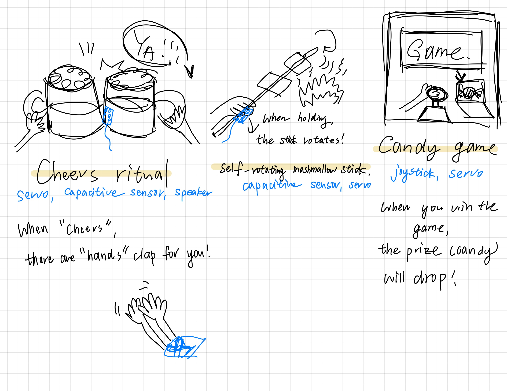

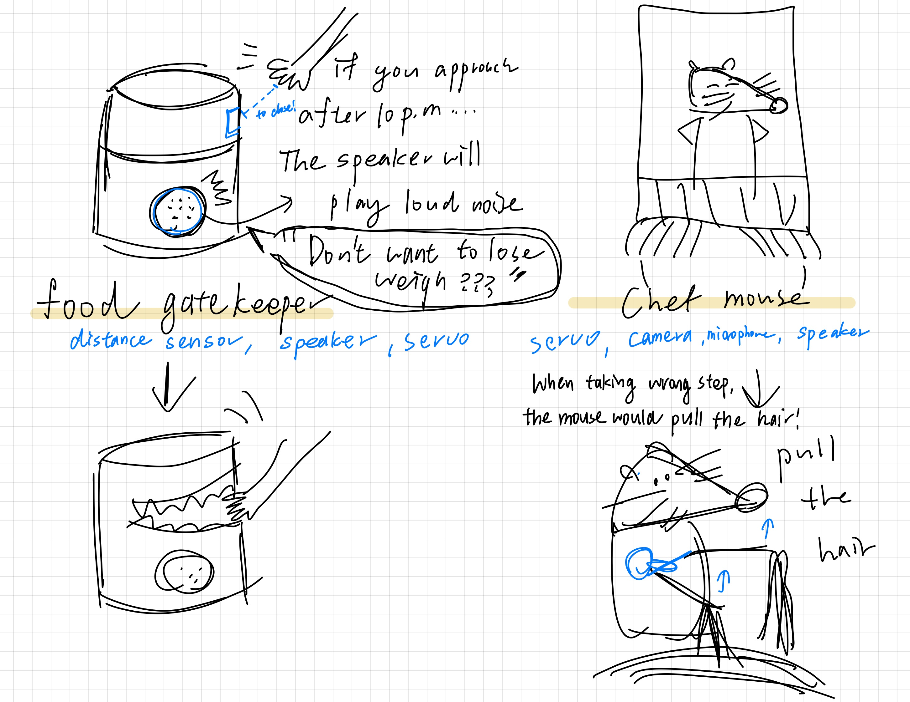

| Sketch | Sensing | Actuation | Where things sit |
|---|---|---|---|
| Cheers ritual | capacitive sensor | servo, speaker | copper pad on the side of the mug; a pair of cardboard hands on a servo under the table clap when two mugs touch |
| Self-rotating marshmallow stick | capacitive sensor | servo | copper tape on the handle; the servo at the end of the stick turns it while it is held over the fire |
| Candy game | joystick | servo | joystick on the front of a cabinet; a servo under the prize box drops a candy when you win |
| Food gatekeeper | distance sensor | servo, speaker | distance sensor behind a hole on the front of the jar; the servo at the hinge snaps the lid shut on a hand that reaches in after 10pm |
| Chef mouse | camera, microphone | servo, speaker | a mouse on the cook's head; a servo in its arm pulls the cook's hair on a wrong step |

\*\***What questions do these sketches raise? What do you need to physically prototype to answer them?**\*\*

- **Cheers ritual:** glass does not conduct, so does a clink register at all, or only
  the hands holding the mugs? Holding a mug is already a touch, so what tells a
  clink apart from just picking it up?
- **Marshmallow stick:** the servo only sweeps about 120°, so the stick rocks back and
  forth rather than turning all the way round. Is that enough to toast evenly, and
  can a 9g servo hold a stick that long at the end of it?
- **Candy game:** what is the game? The joystick is only an input, so the screen or
  board has to carry the whole game, and the drop needs a trapdoor that opens
  every time and does not jam.
- **Food gatekeeper:** where does the sensor have to sit so it sees a hand reaching
  for the jar and not someone walking past? How far should the hand be when the
  lid starts to close, and can the servo close it fast enough to feel like a bite
  without hurting anyone?
- **Chef mouse:** nothing in the kit can tell a wrong step in cooking. That needs a
  camera and some kind of recognition, which is a much bigger project than the
  servo.

For the gatekeeper, the questions are physical ones, so they need a cardboard jar
to answer: the sensor's height and angle, the trigger distance, how the servo horn
connects to the lid, and how fast the lid can move.

\*\***Pick one design to prototype and explain why.**\*\*

The **food gatekeeper**. One distance reading drives one servo motion, so the
sensing and the actuation map onto each other directly, and the lid is the thing
your hand was going for anyway, so the response lands exactly where the action
is. The 10pm rule gives it a personality without making the electronics any
harder, and the whole thing can be built from a cardboard box with the servo on
the hinge. The speaker is an extra that can come in once the lid works.

\*\***Document your rough prototype with photos and/or video.**\*\*

The jar is a cardboard box with its flap as the lid, and
[`food_gatekeeper.py`](food_gatekeeper.py) runs it.

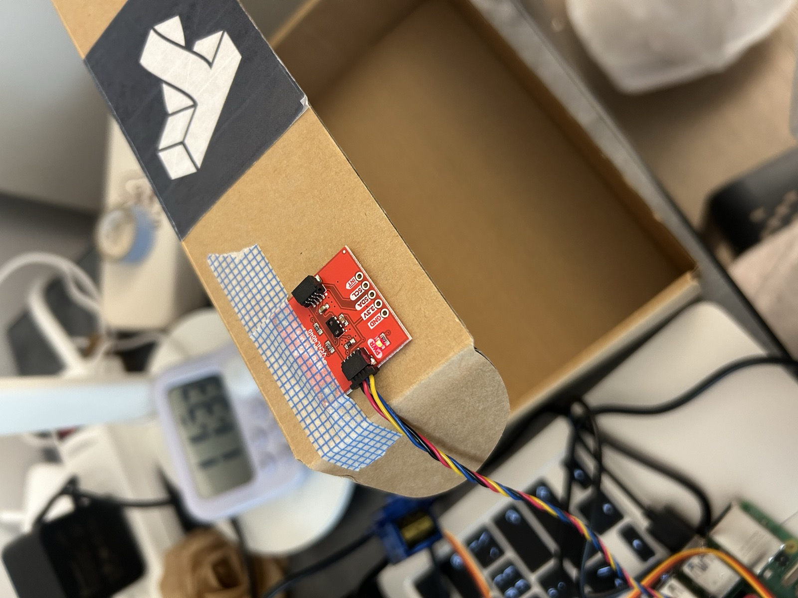
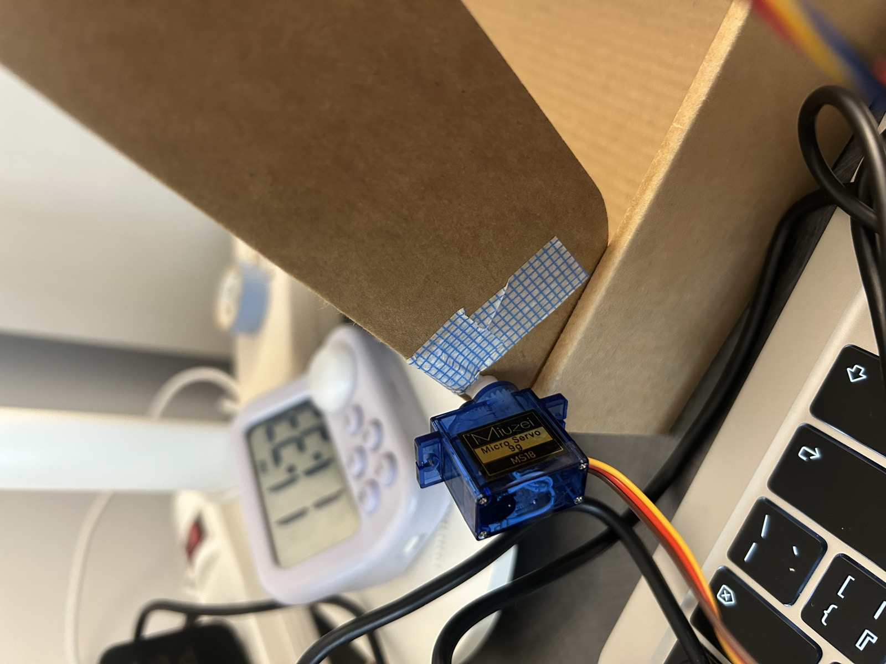
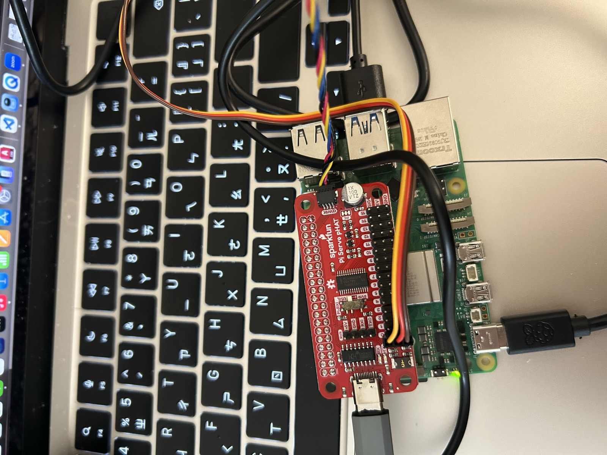

The proximity sensor is taped to the front edge of the lid, the servo sits at the
back corner with its horn taped to the lid at the hinge, and the Servo pHAT on the
Pi drives the servo on channel 0 with its own USB-C supply. The sensor ended up on
the lid rather than behind a hole in the front as sketched, because the front
edge is where a hand comes in.

[**prototype_demo.mov**](prototype_demo.mov) shows a hand reaching for the box and
the lid snapping shut on it.

With nothing in front of it the sensor reads 0 to 4, and a hand near the box
reads anywhere from about 40 to 145, so the lid closes above 60. A hand that
comes in fast jumps straight past that, and one that creeps in slowly has to get
quite close before it does. The lid closes in one jump so it reads as a bite,
stays shut until the hand has been gone for three seconds, and then opens again
slowly. The servo turned out to be mounted the opposite way round to what the
code first assumed, so open is 10° and closed is 100°.

---

# Lab 4 Part 2

## E. Build & Integrate: Sensing + Actuation

[`food_gatekeeper.py`](food_gatekeeper.py) is the code for the sensing and actuation.

**The story.**

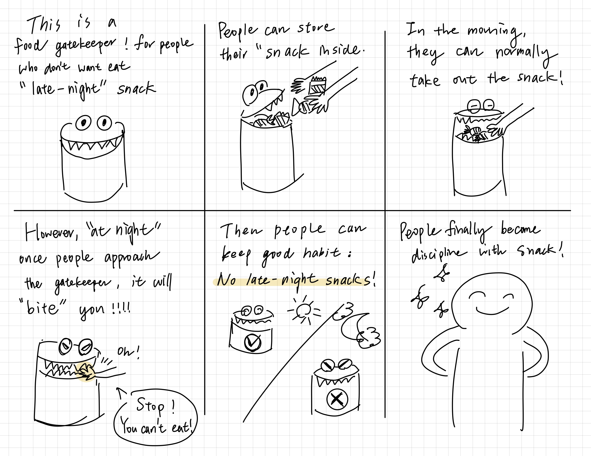

The gatekeeper is for people who do not want to eat late-night snacks. During the
day it is an ordinary snack jar, and anyone can put snacks in or take them out.
At night, a hand reaching in gets bitten, and the jar tells them to stop. The
point is the habit it leaves behind: no snacks after dark.

**How sensing and actuation connect.**

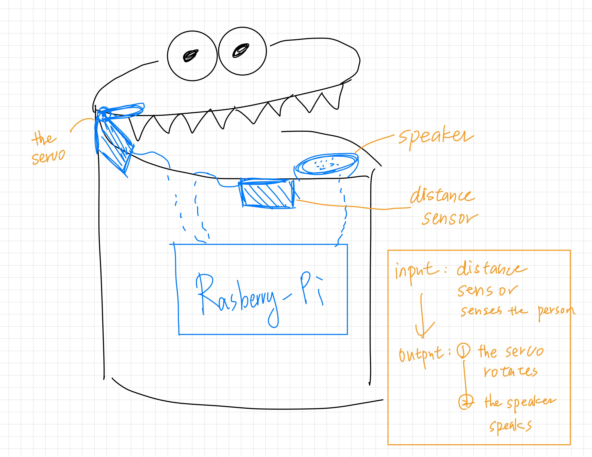

The distance sensor sits at the front of the rim where a hand comes in, the servo
at the hinge moves the lid, and the Pi is hidden in the body of the jar. When the
sensor sees a person, the servo closes the lid first and then the speaker speaks.

**Questions to consider.**

- **How does the sensor shape the response?** The proximity sensor only knows how
  close something is, not what it is, so the jar treats every close hand as a
  snack thief. That fits the joke, since at night any hand is a suspect.
- **How does the arrangement change the interaction?** The sensor has to be where
  the hand comes in. In the first box it sat on the lid; in the second it moved to
  the front rim just under the teeth, which does not move when the lid does. The
  servo sits at the hinge, so the lid swings like a jaw instead of sliding.
- **What makes it feel clear or playful?** The lid closes in one jump rather than
  a sweep, which is what makes it feel like a bite. It stays shut for three
  seconds after the hand leaves and then opens slowly, so it seems to calm down
  rather than snap back.
- **What changes when you adjust placement or motion?** The threshold decides how
  close you get before it bites. At 60 a fast reach triggers it straight away,
  but a slow one has to get quite close. The servo also turned out to be mounted
  the other way round, so open and closed had to be swapped.

**Reflection.** Connecting the sensor to the servo was the easy part; most of
the work was physical. Where the sensor sits, which way the servo is mounted and
how light the lid is all decided whether it worked at all. The fun part was how
much the look changes the same motion: in a plain box the lid just closes, but
with teeth and eyes it bites. The surprise was how much the timing matters,
since the instant close and the slow reopen do more for its personality than
anything in the code.

## F. Final Documentation

**Looks like.** The second build moved into a bigger box and became a face, one
step at a time.

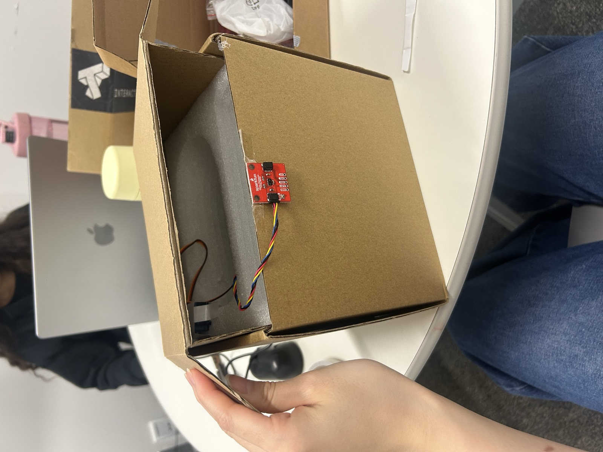
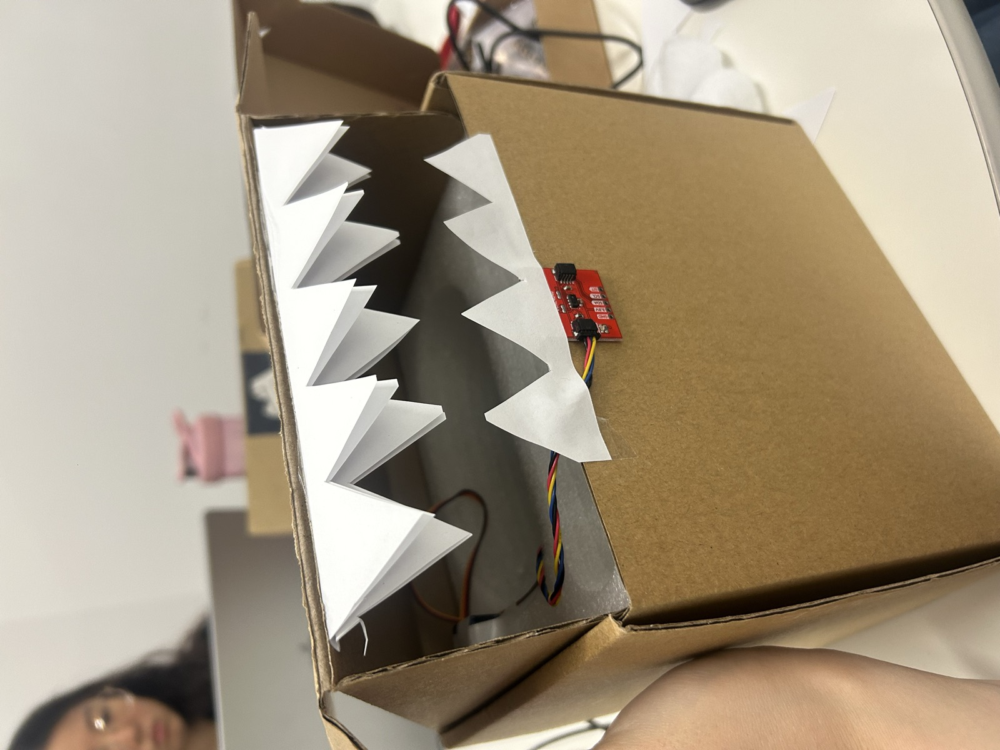
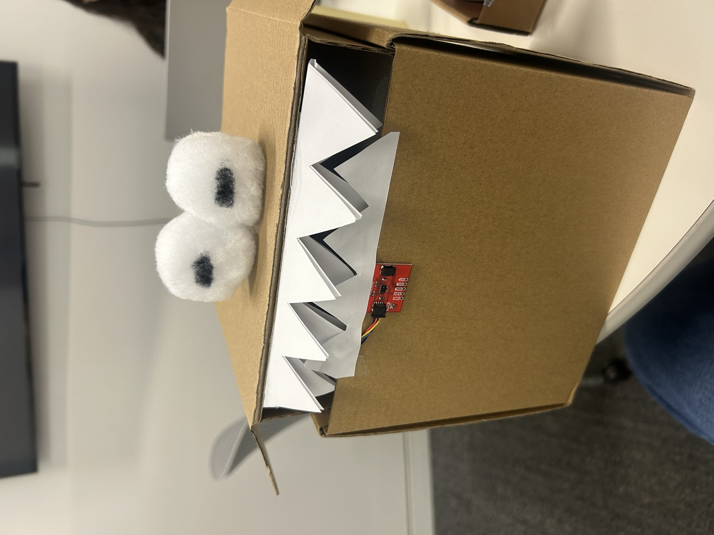

First the box, with the sensor in the middle of the front rim. Then paper teeth on
the lid and the rim, so the lid reads as a jaw, with the sensor just below the
bottom row. Then two pompom eyes on the lid, which turn the box into a monster.

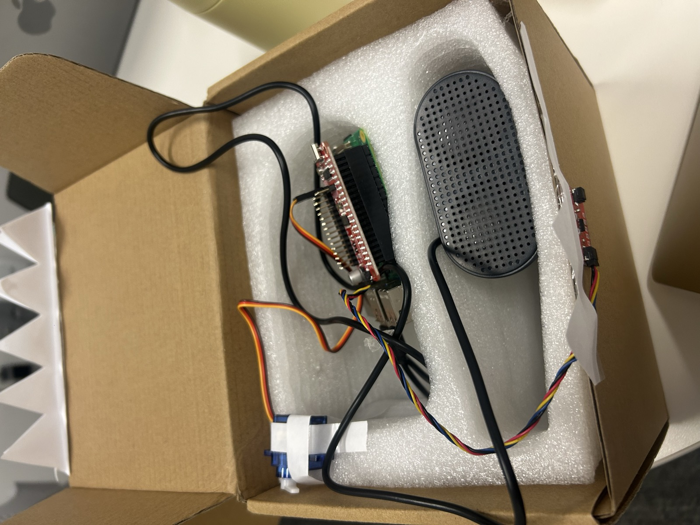

Inside, everything sits in cut packing foam: the servo is taped in the back
corner at the hinge, the Pi with the Servo pHAT sits next to it, and the speaker
lies along the front. Only the sensor shows on the outside.
