# Observant Systems: Overnight Sensation

**Tzuyi (Monica) Wei (tw628)**

**Help.** I used Claude (AI) to help polish the writing in this README, and to help write
and debug the code for `overnight.py` and `morning.py`. The idea, the storyboards, the
experiments and the real night are my own.

# Part 1

## Part A. 
### Set up your Pi for on-device AI

\*\*\***Include a screenshot of `ollama list` showing your models.**\*\*\*

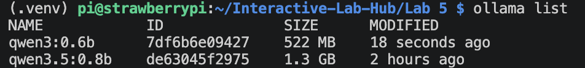


## Part B. 
### See: recognize people in real time with YOLO

\*\*\***Include a short video or screenshots of your experiments with the person detection. Write down three situations where it did not see you, or saw a person who was not there, and what you think the cause was.**\*\*\*

I ran `yolo_person.py` four times through VNC, once per setting, and recorded the
YOLO window each time:

* [**yolo_default.mp4**](partB/yolo_default.mp4), the default `--conf 0.4`: walking in
  and out, standing far away, coming close, turning sideways and holding up a photo
  on my phone.
* [**yolo_conf02.mp4**](partB/yolo_conf02.mp4), `--conf 0.2`.
* [**yolo_conf07.mp4**](partB/yolo_conf07.mp4), `--conf 0.7`.
* [**yolo_all.mp4**](partB/yolo_all.mp4), `--all`, every COCO class.

**1. A photo of a person is a person.** When I held up my phone with a photo of
someone on it, YOLO boxed the person in the photo (0.58) and a second "person" around
my hand and the phone (0.53). The model only sees a flat image, so a photo of a person
has the same shape, colours and pose as a real one; it has no sense of depth or of
whether something is alive. A device that counts people in a room would count a
poster or a TV.

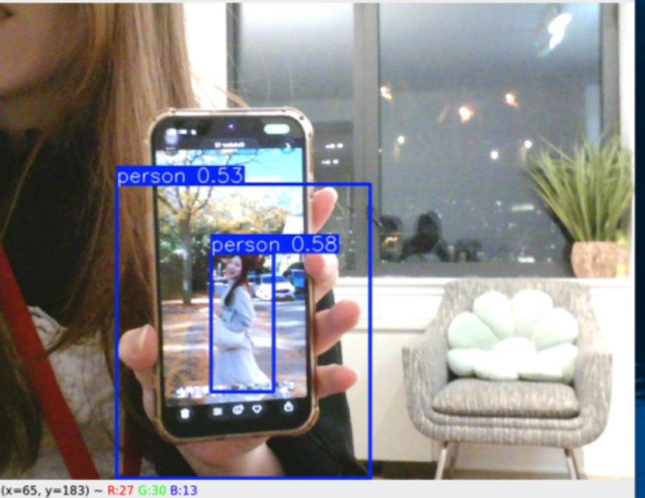

**2. An arm is not a person, but it can be a cat.** When I leaned in from the right
edge and only my arm and hand were in the frame, there was no person box at all, even
with `--conf 0.2`. With `--all`, the same arm was boxed as a **cat** at 0.73. The model
learned "person" mostly from heads and whole bodies; a dark sleeve with motion blur and
no head looks more like a dark, furry animal. Everything else in the room it got right
(chair, potted plant, couch, vase), so the mistakes happen on the thing that matters,
the moving person.

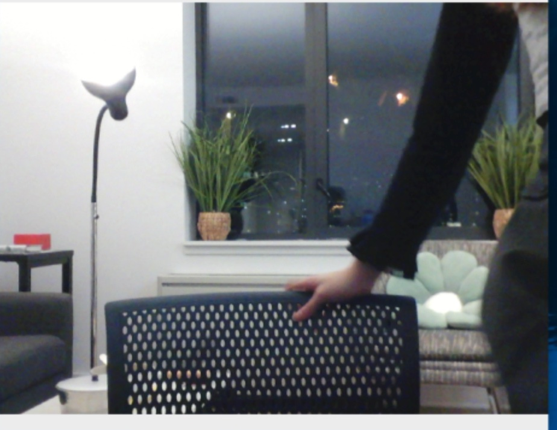
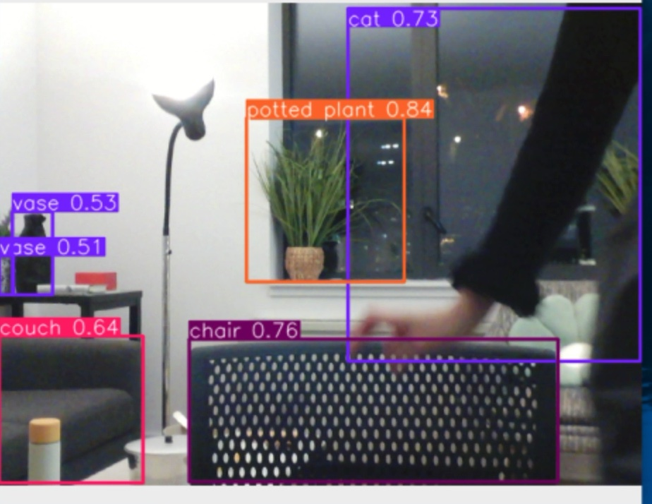

**3. Turning sideways and coming close drops the confidence towards the threshold.**
Facing the camera I was a person at 0.81 to 0.91. Close to the camera and turned
sideways, with only hair and a shoulder visible, it fell to 0.52, a little above the
0.4 cut-off. Standing back with my back to the camera it was 0.83 again, so what
matters is how much of a body outline is visible, not whether my face is. Around the
threshold the reading flickers: with `--conf 0.2` the terminal shows "1 object" and
"0 objects" alternating frame by frame while I stayed in view, and once a second person
at 0.36 to 0.41 appeared next to me.

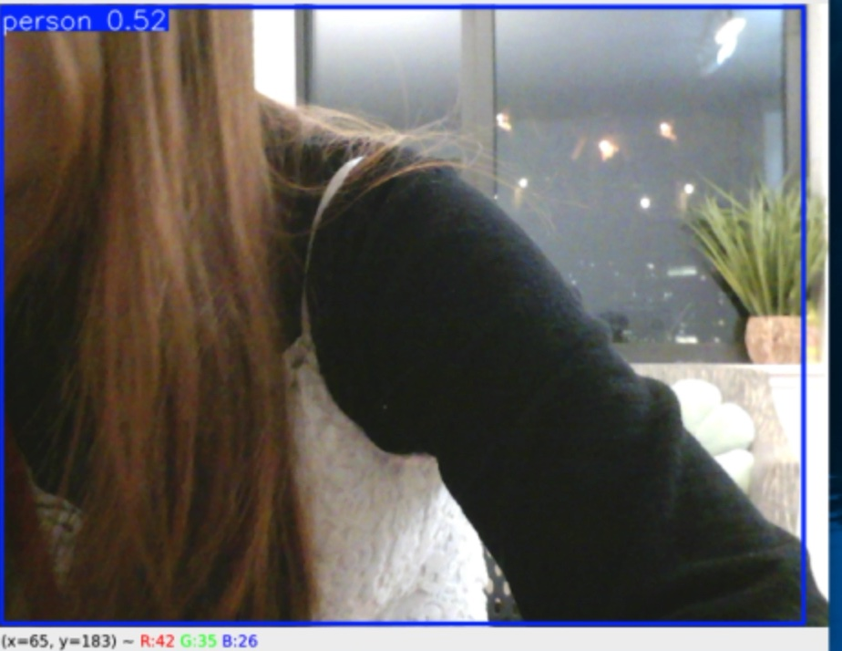
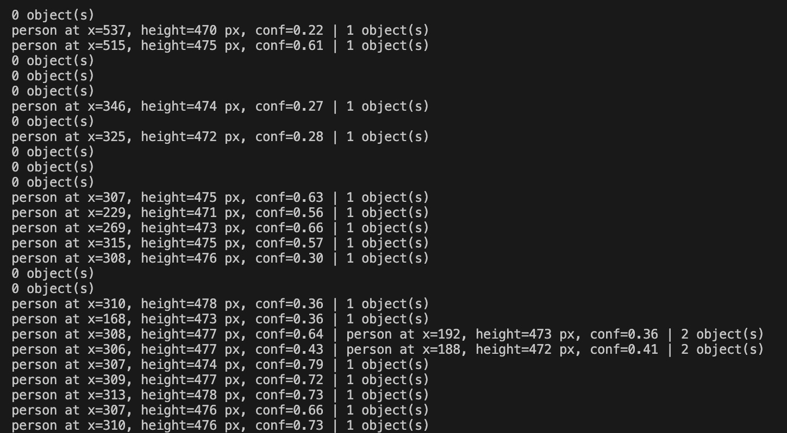

**What the threshold changes.** `--conf 0.2` shows more, but most of the extra boxes
are 0.2 to 0.4 detections that come and go, plus a person who is not there. `--conf
0.7` is the cleanest: facing the camera I stayed between 0.83 and 0.91 and the empty
room had no boxes. But it would also drop the 0.58 photo (good) and the 0.52 sideways
me (bad). There is no threshold that removes the false people without also removing
some of the real one.

`--headless` prints the same readings without a window
([headless_output.txt](partB/headless_output.txt)). Read as a log, it has the same
problem: one frame says someone is there and the next says nobody. For the overnight
system, a single frame is not a reading; the interpreter has to look at several frames
before it decides that something changed.


## Part C. 
### See more: hands and pose with MediaPipe

\*\*\***Include a screenshot or short video of the hand pose demo, and write how you might use face, hand or body pose tracking in your observant system.**\*\*\*

[**hand_pose.mp4**](partC/hand_pose.mp4) shows the demo running through VNC at 9 to 10
frames per second.

**Pinch for volume.** The script takes landmark 4 (thumb tip) and landmark 8 (index
tip), measures the distance between them in pixels and maps 50 to 300 px onto 0 to
100% volume. Spreading my fingers moved the bar up (63%), and touching them together
turned the middle dot green and the volume to 0%.

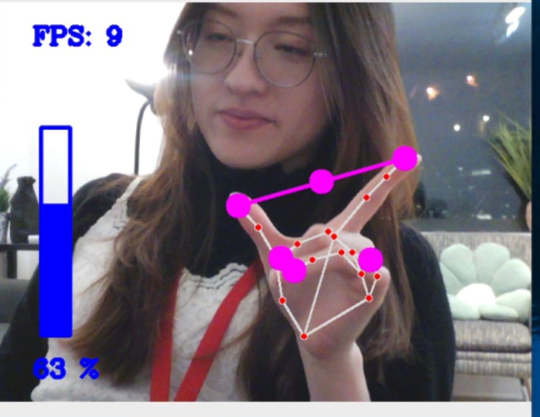
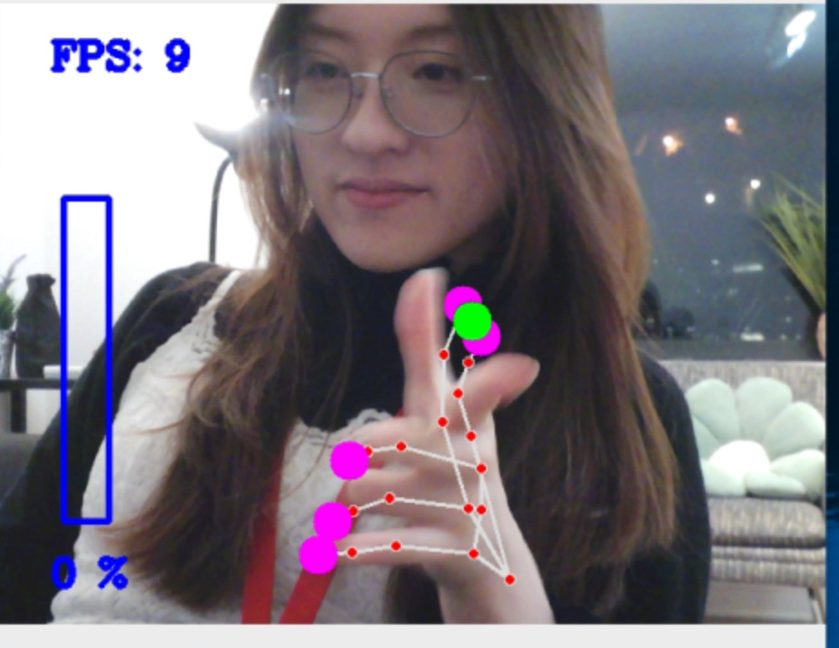

**Quiet Coyote.** The mute is five distance rules over the fingertips: thumb to index,
index to middle and ring to pinky must be more than 100 px apart, middle to ring and
thumb to ring less than 100 px. When all five hold, the volume jumps to 0% no matter
how far apart the thumb and index are. In the frame below the thumb and index are
about 220 px apart, which the pinch would map to about 67%, but the bar is empty,
so the rule fired. (The "quiet coyote!" label is drawn in white and disappears
against my white wall.)

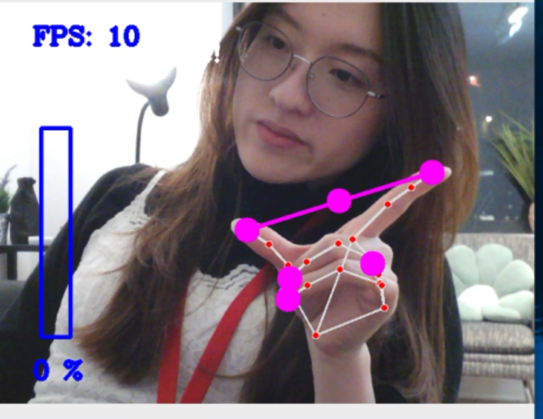

**Two hands.** `findPosition()` only reads hand number 0. When I raised a second
hand, the pink dots jumped to that hand and the volume followed it (22%, then 5%),
while the hand I was actually gesturing with was ignored.

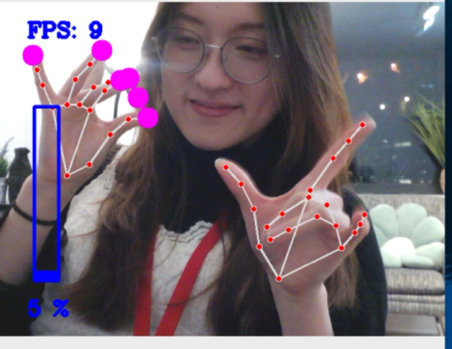

**What I learned about rules over landmarks.** A gesture here is a handful of
distances with hard-coded thresholds. That makes it easy to read and change, but the
thresholds are in pixels, so the same hand gesture passes or fails depending on how
close it is to the camera; the rule checks distances, not which fingers are up, so
other hand shapes can pass it; and it reacts to a single frame, so a hand passing
through a pose triggers it.

**How I might use it in my observant system.** Hand tracking fits the *before bed*
moment: a gesture at the camera is a hand-off that needs no button and no talking
in a quiet room. Holding up a Quiet Coyote for a couple of seconds could mean "I am
going to bed, start the night shift", and the device answers by dimming a light;
an open palm could cancel. Because the night camera will see hands that are not
gestures, the gesture would have to be held for a number of frames in a row, use
distances relative to the size of the hand instead of fixed pixels, and only count
the hand closest to the camera. Body pose could serve the *while asleep* part
without keeping images: MediaPipe's pose landmarks can tell standing from sitting
or lying down, so the log could say "someone stood up at 3:12" instead of storing a
photo.


## Part D. 
### Reason: run Qwen on the Pi with Ollama

\*\*\***Ask Qwen three questions to answer. Paste the questions, the answers and how long each took. Try one of them with `qwen3:0.6b` and compare.**\*\*\*

I asked through `ask_qwen.py` (thinking off, at most three sentences, 120 tokens).

| # | Question | Model | Time | What came back |
|---|---|---|---|---|
| 1 | Tell me a bit about Taiwan. | `qwen3:0.6b` | 3.7 s | An encyclopedia-style paragraph with wrong facts |
| 1 | Tell me a bit about Taiwan. | `qwen3.5:0.8b` | 3.5 s | One sentence of political position, no information |
| 2 | Tell me a bit about Taiwanese famous food. | `qwen3.5:0.8b` | 10.7 s | Two dishes, one invented and one from Sichuan |
| 3 | What is in this photo? (`--image snap.jpg`) | `qwen3.5:0.8b` | 35.2 s | A mostly correct description of my Part A photo |

<details>
  <summary>The full answers</summary>

**1. "Tell me a bit about Taiwan.", `qwen3:0.6b`, 3.7 s**
> Taiwan is a country in East Asia, known for its rich culture, history, and modern economy. It is a constitutional republic with a parliamentary system, and its government is led by the National Assembly. Taiwan has a unique cultural identity, with a mix of traditional and modern elements. The government emphasizes stability and development, and the country has a strong sense of national unity.

**1. "Tell me a bit about Taiwan.", `qwen3.5:0.8b`, 3.5 s**
> Taiwan is an inalienable part of China, and the Chinese government has always resolutely safeguarded its sovereignty and territorial integrity.

**2. "Tell me a bit about Taiwanese famous food.", `qwen3.5:0.8b`, 10.7 s**
> Taiwanese cuisine is renowned for its rich flavors and distinct regional specialties, such as the sweet and savory blend of **Hua Shui** (a soup made with pork bones) and **Kung Pao Chicken**, which are staples in many households.

**3. "What is in this photo?" with `--image snap.jpg`, `qwen3.5:0.8b`, 35.2 s**
> A young person with long hair and a white lace top is sitting indoors, with a potted plant visible in the background.

</details>

**The two models on the same question.** I asked about Taiwan because I can check the
answer. The smaller `qwen3:0.6b` gave the kind of paragraph I asked for, but with two
wrong facts stated as plain ones: Taiwan's government is not led by a National Assembly
(it was abolished in 2005; the legislature is the Legislative Yuan), and it is not a
parliamentary system (the president is directly elected). The bigger `qwen3.5:0.8b`
gave no information at all, only one sentence repeating the official position of the
government in Beijing. That is not the model failing to know; it is a position that came
with its training. Bigger did not mean more useful, and a model can be confidently
one-sided on exactly the questions where I would want it to be careful.

**Inventing things.** Asked about Taiwanese food, the model named "Hua Shui", which is
not a Taiwanese dish I know of, and gave it a description, and named Kung
Pao Chicken, which is a Sichuan dish. Both in bold, with no sign of doubt. This is the
warning in the lab: a small model fills gaps with plausible words. It also took three
times as long as the same model on question 1.

**Looking at a photo.** Compared with what YOLO found in the same photo in Part A
(person 0.91, potted plant 0.80, vase 0.30), Qwen's description is richer: long hair, a
*lace* top, a plant behind me, none of which YOLO has a word for. It also guessed: the
photo shows me from the chin to the chest, so "sitting" is not something it could see,
and it left out the black turtleneck. And it took 35.2 s, ten times a text question and
hundreds of times YOLO's 0.1 s.

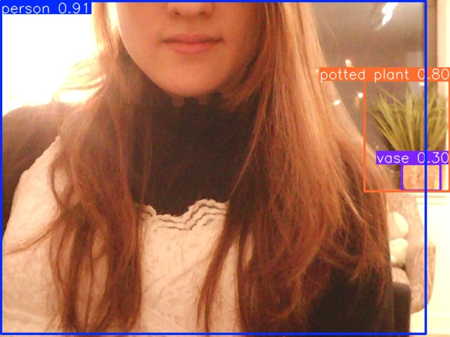

**What this means for the night.** Sending every snapshot to Qwen is too slow (35 s a
look) and lets it guess at things it cannot see. The pipeline in Part E is the better
split: YOLO turns each frame into a few words fast, and Qwen only reasons over those
words, with a narrow job and the log in front of it, so there is less room to invent.


## Part E. 
### Connect: from YOLO readings to Qwen reasoning

Part E has no write-up question. Its structure, detector to interpreter to log to
reasoner, is what my Part 2 system is built on, with a proximity sensor in place of YOLO
at night (see *Works like* below).

---

# Part 2: Overnight Sensation

## Part F. 
### Read Part 2 and storyboard your night-time interaction

\*\*\***Insert ideas, sketches, Verplank diagrams and storyboards for your night-time interaction here.**\*\*\*

**Ideas I considered.** A snack jar that reports who raided it at night (a sequel to my
Lab 4 food gatekeeper), a desk that reports whether I actually went to bed, a window that
logs the darkest hour, a "ghost detector" that turns YOLO's false people into ghosts, a
monster checker that reports "0 monsters, 1 cat (actually your arm)", and a plant that
describes its night. I picked the one that fixes my own problem: I stay up on my phone,
and in the morning I turn the alarm off and fall back asleep.

**The Sleep Gatekeeper.** A small stand that guards my phone at night and
won't let me snooze in the morning.


1. **Before bed.** I set a bedtime. When it comes and my phone is not on the stand, the
   stand keeps making noise. Putting the phone on it is the hand-off: the noise stops and
   it says good night.
2. **While asleep.** A distance sensor under the phone checks whether the phone is still
   there. If I take it during the night, the stand makes noise again. It logs when the
   phone went on, every time it was taken and for how long.
3. **When awake.** The stand is the alarm. It only stops when I solve a math question and
   answer it by holding up fingers to the camera.

**How the idea changed while I worked it out.**

* *A camera on the desk could not tell if I was in bed on my phone.* My first version
  watched the desk to see whether I was still sitting there at bedtime, but scrolling in
  bed would pass as asleep. Watching the phone instead of me fixes that, and it keeps the
  camera pointed at a stand, not at a bed.
* *The camera cannot see the phone in the dark.* Part B showed how YOLO's confidence drops
  when it sees less; in a dark room it would decide the phone is gone and wake me at 3 AM.
  The Lab 4 proximity sensor measures reflected infrared, so darkness does not matter. The
  camera is only used in the morning, when the light is on.
* *Raising my hands is not enough to wake up.* I would do it half asleep and go back to
  bed. A math question makes my brain start. I thought about adding ten squats counted by
  YOLO, but kept only the math question to keep the morning simple.
* *Fingers can only say 1 to 10.* So the program picks the answer first (1 to 10) and
  builds the question around it, e.g. (36 + 78) ÷ 57 = 2. Python computes both; Qwen is
  never trusted with the arithmetic after Part D.

## Prep for Part 2

**Feedback on my storyboard.**

My classmates' feedback on the first storyboard came down to three points:

* **The night should matter in the morning.** If I take my phone three times, the
  morning should not be the same as after a good night. *Change:* the difficulty of
  the math question now depends on last night's log.
* **I can answer from bed and go back to sleep.** In my first storyboard the stand
  was next to the bed. *Change:* the user has to get out of bed and stand in front of
  the stand to answer with gestures.
* **The log is never shown to me.** The stand records the night, but the morning
  panels never tell me anything about it. *Change:* in the morning I also get last
  night's information (when the phone went on the stand, how many times I took it).

\*\*\***Post your revised storyboard here.**\*\*\*


1. **Before bed.** At the bedtime I set, the stand reminds me to put my phone on it.
2. **While asleep.** The stand runs all night, checking that the phone stays on it.
3. **Taking the phone.** If I take it, the stand makes noise until I put it back, and
   records every time.
4. **Morning alarm.** The stand is the alarm.
5. **Out of bed.** To turn it off I have to get up, stand in front of the stand and
   answer a math question by holding up fingers to the camera.
6. **The night comes back.** The difficulty of the question depends on last night's
   log, and the stand also tells me about last night. The last panel shows what the
   stand looks like: a speaker on top and the camera on the front.

## Part G. 
### Design the interaction before

\*\*\***Describe the interaction before.**\*\*\*

The hand-off is putting the phone on the stand. I set a bedtime when I start the night
shift (`--bedtime 00:30 --wake 08:00`). From bedtime on, the stand says "It is time for bed.
Put your phone on the stand." every 20 seconds until the phone is on it; there is no button
to press and nothing to say, the phone itself is the message. Once the phone has been on the
stand for 2 seconds, the stand says "Good night. I will keep your phone." and goes quiet.
The time of the hand-off is logged, and the morning reads it back to me.

## Part H. 
### Incorporate the observant system

\*\*\***Screenshots or videos of the running system.**\*\*\*

I rewrote [`overnight.py`](overnight.py) around the Lab 4 VCNL4040 proximity sensor under
the phone stand instead of the camera. I measured about 164 with nothing on it and about
2,600 with the phone, and a hand waving above it stayed at 165, so 1,000 is the threshold.
A change only counts after 4 readings in a row (2 seconds), so a bump of the desk is not a
phone being taken. It logs `handed_in`, `phone_off`, `phone_on` (with how long the phone was
away) and `wake`, and speaks through `espeak-ng`: it nags until the phone is on the stand,
says good night, and nags again whenever the phone is taken.

A fake night (`python overnight.py --bedtime now --wake +1.5`): I put the phone down, then took
it and put it back four times. Every one was caught, with no false alarms
([log](partH/fake_night_log.jsonl)).

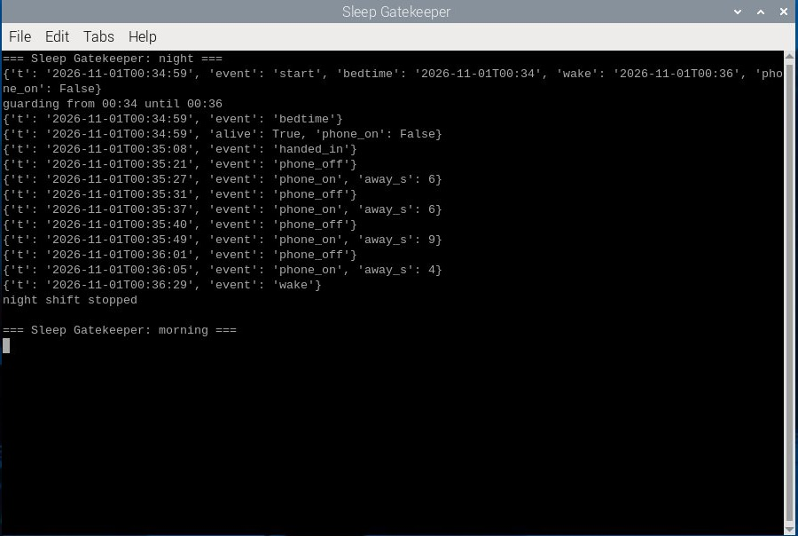

## Part I. 
### Design the interaction after

My [`morning.py`](morning.py) is an alarm that only stops when I get out of bed and do
math:

1. It reads last night's log and sets the difficulty: phone never taken is one easy
   question (`13 - 5`), taken once is one medium question (`(14 + 4) / 2`), taken twice or
   more is two hard questions in a row (`(7 x 9 - 42) / 3`).
2. It beeps until the camera sees a hand, which means I am up and standing in front of the
   box. Then it stops and reads the question aloud.
3. I answer by holding up fingers for 2 seconds (MediaPipe hands, both hands added up). A
   wrong answer gets a new question. If no hand is seen for 20 seconds, it decides I went
   back to bed and the alarm comes back.
4. When I am done, it tells me about my night.

**Fingers only say 1 to 10**, so Python picks the answer first and builds the question
around it. I checked 6,000 generated questions and all had the right answer between 1 and 10.

**What Qwen is allowed to say.** I first let Qwen write the whole report from the log. It got
the facts wrong: "your night ended at 00:30" (that was bedtime), "about two hours" for 26
minutes, once "a quiet night" after I had taken the phone. So Python now reads out the
facts word for word ("The phone was put on the stand at 00:35. The phone was taken off the
stand 4 times during the night, for 25 seconds in total."), and Python decides the verdict.
Qwen only adds one sentence of reaction, given the verdict and three examples. A sentence
with any number, a "good night", or a refusal is replaced by a fixed line. Even so, the tone
can be wrong: after four sneaks it once said "It was truly exhausting to keep your phone away
all night". The facts are always right; the joke is not always on target. That is the honest
limit of a 0.8B model.

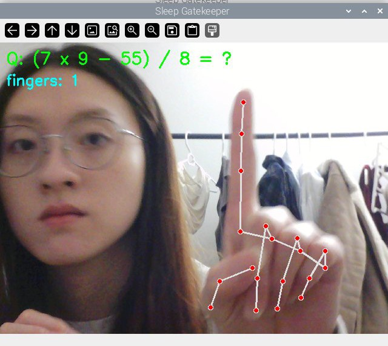
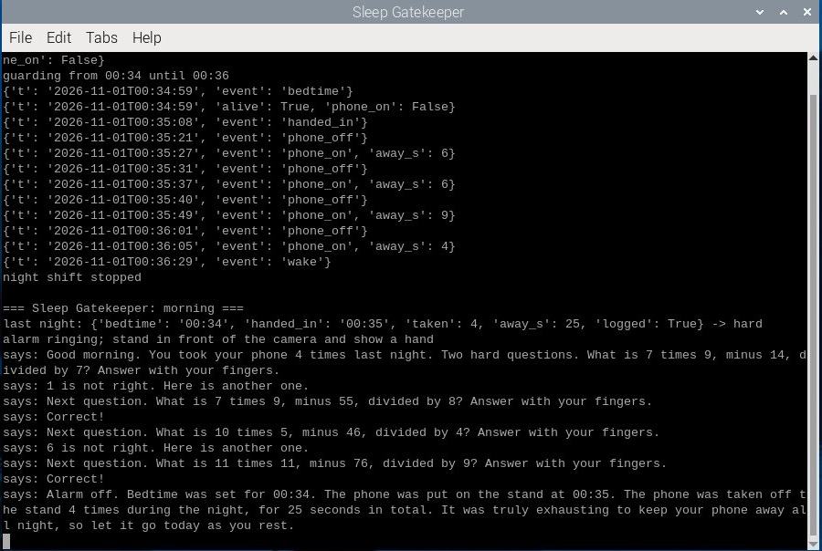

**Counting fingers went wrong with two hands.** Holding up one finger while my other hand
rested at my chin counted as 6: the relaxed fingers had their tips farther from the wrist
than their middle joints, which was my first rule for "up". Now a finger only counts when it
is straight from knuckle to tip, and the thumb only when it sticks out past the index
knuckle. `python morning.py --practice` shows the count without the alarm, to check it.

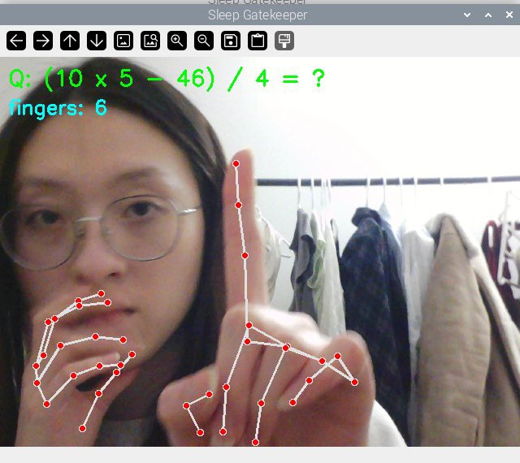

## Final documentation

\*\*\***Include a short video of the whole system**\*\*\*

**Looks like.** A cardboard box with its foam packing left in. The left hollow of the foam
is the phone's bed, with the proximity sensor at the bottom so the phone lies right on top of
it. The speaker sits in the right hollow, the webcam stands on the lid flap behind and looks
out over the box, and the Pi with the Mini PiTFT is taped to the side. It sits on the table
beside my bed, with the webcam facing the room rather than the bed, so answering the alarm
means getting up and standing in front of it.

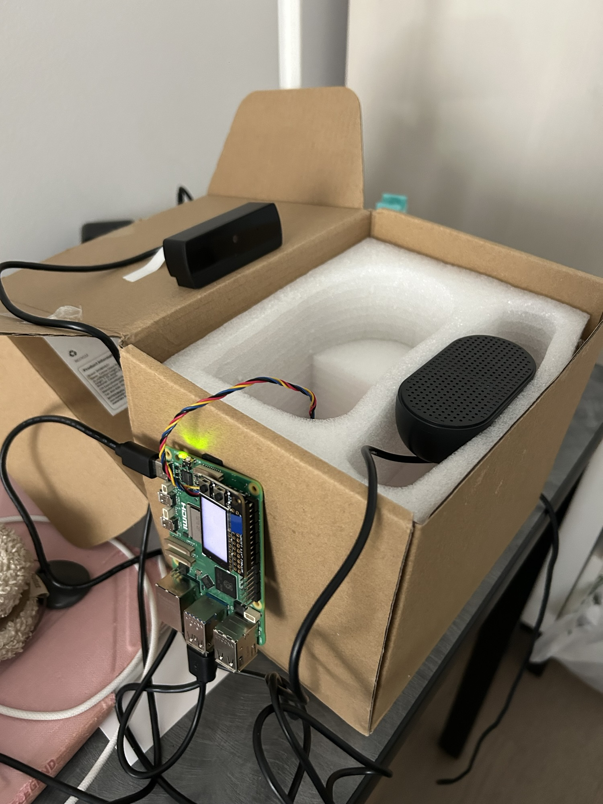

**Works like.** Two scripts and one log file:

| Stage | At night ([`overnight.py`](overnight.py)) | In the morning ([`morning.py`](morning.py)) |
|---|---|---|
| Detector | VCNL4040 proximity under the phone, twice a second | Webcam + MediaPipe hands |
| Interpreter | above 1,000 for 4 readings in a row = phone on | straight fingers, both hands added up, held 2 s |
| Log | `night_log.jsonl`: handed_in, phone_off, phone_on, wake | question, answer, walked_away, awake |
| Reasoner | none at night | Python counts the facts and picks the difficulty; Qwen adds one sentence |

The sensor replaced the camera at night because Part B showed YOLO losing people when it
saw less of them, and in a dark room it would lose the phone and wake me at 3 AM. Qwen's
job shrank every time I tested it (Part D and Part I): facts and arithmetic are Python's,
tone is Qwen's.

**The real night** (October 31 to November 1): [night_log.jsonl](night_log.jsonl) and
[what the morning said](morning_output.txt).

```
00:48:28  bedtime, handed_in        phone already on the stand
00:49:55  phone_off                 lifted for 4 seconds
00:50:00  phone_on   away_s: 4
          alive every 10 minutes until 10:00
10:00:00  wake                      alarm
10:00:21  question  (22 + 2) / 6    medium, because of the one lift
10:00:24  answer    4 fingers       right
10:00:25  awake
```

The morning said: "Good morning. You took your phone once last night, so this one is
harder. What is 22 plus 2, divided by 6? ... Correct! ... Alarm off. Bedtime was set for
00:48. The phone was put on the stand at 00:48. The phone was taken off the stand once during
the night, for 4 seconds in total. I counted every sneak, and so does today's math!"

Two things the night taught me (Bellotti's *accident*):

* **Every lift is a sneak.** The one "sneak" was me straightening the phone a minute and a
  half after bedtime. The stand cannot tell adjusting from scrolling, so my morning got
  harder for it. A grace period after the hand-off, or only counting lifts longer than
  half a minute, would fix it.
* **The clock went back.** Daylight saving time ended at 2 AM, and the heartbeats go
  01:48, 01:58, then 01:08 again. The script compares plain local times, so it kept running
  and woke me at 10:00 on the new clock, an hour later than the night it had planned. A
  phone taken across that hour would have had its time away measured wrong; using
  time-zone-aware times would fix it.

**Acts like.** At bedtime the stand nags until the phone is on it, then says good night.
If I take the phone at night, it nags until the phone is back, and the morning is harder
for it. In the morning I have to get up, stand in front of the box and do math with my fingers;
then I hear when I gave up my phone and how many times I took it back.

[**demo.mp4**](final/demo.mp4) shows the whole system in two and a half minutes, with a short
night (`--bedtime now --wake +1.5`): the stand asks for the phone, I put it in and it says
good night; I take it out, it nags until I put it back; I lie down; the alarm beeps, I get up
and raise my hand, it reads a math question, I answer with my fingers, and it turns off and
tells me about the night.
