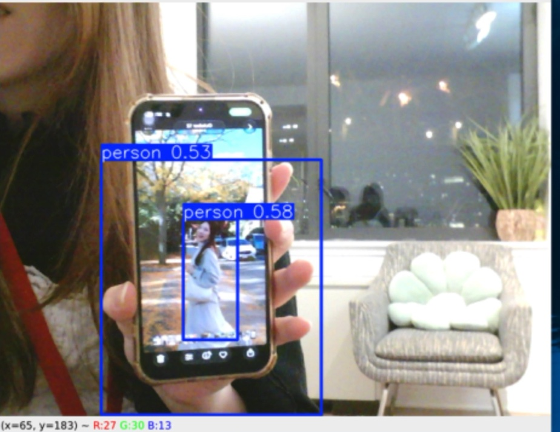
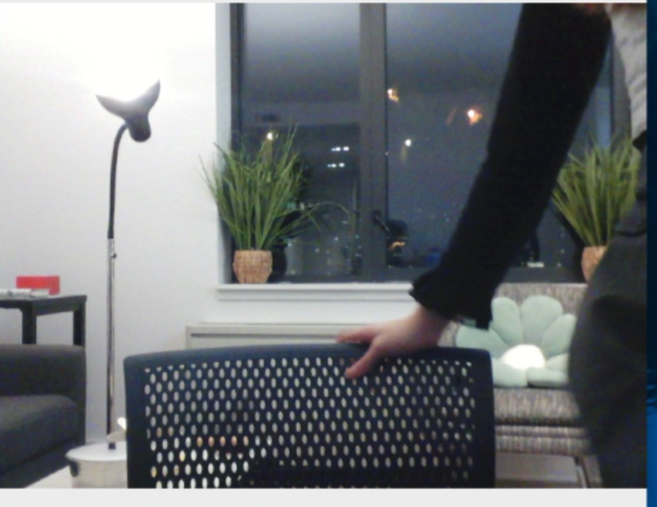
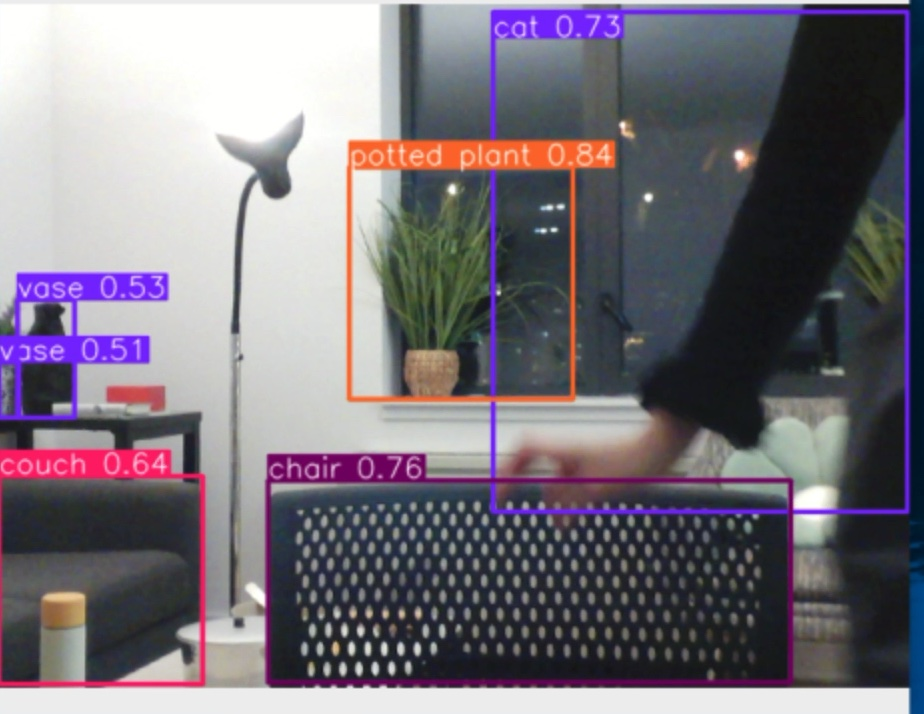
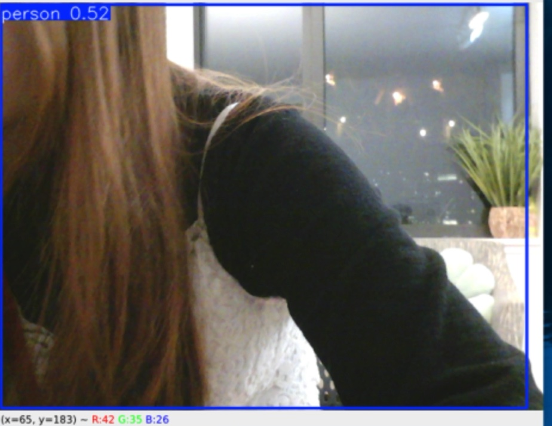
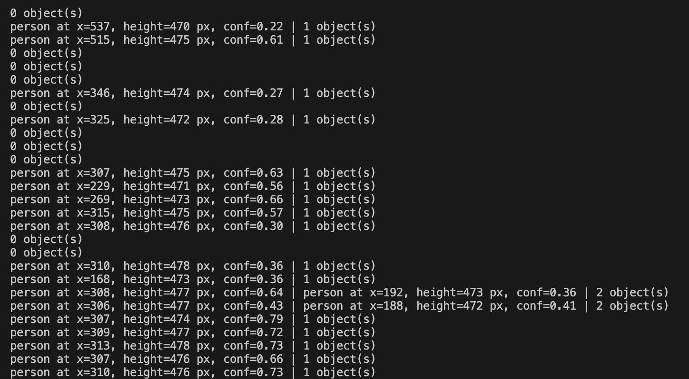
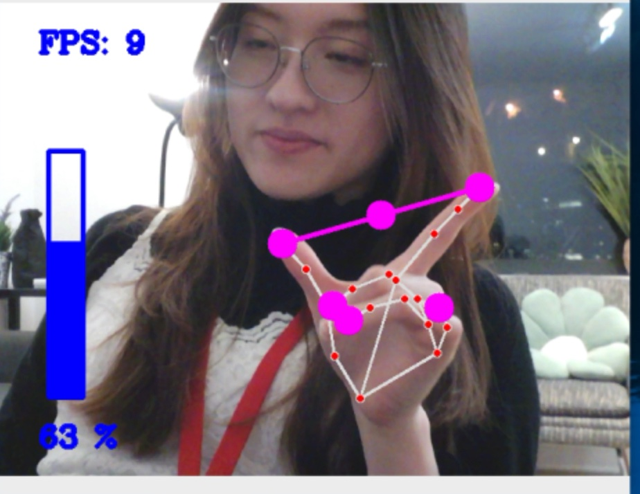
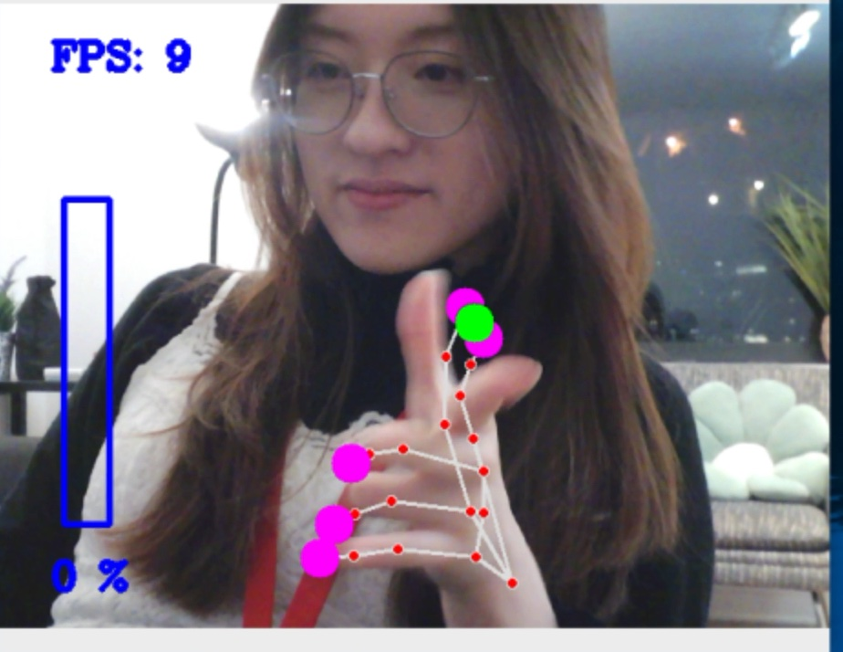
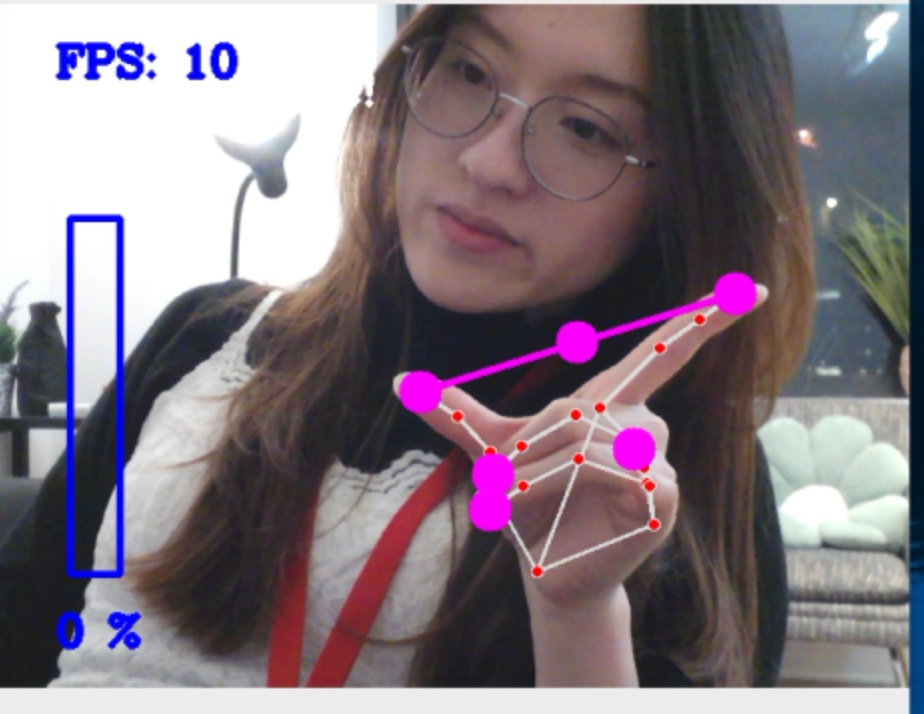
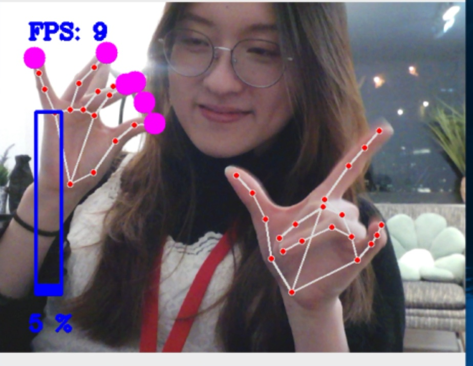
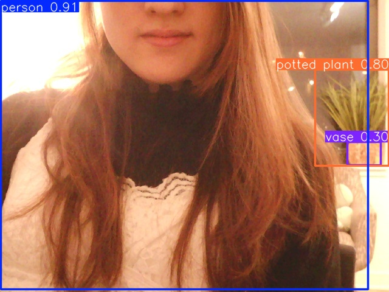

# Observant Systems: Overnight Sensation

**Tzuyi (Monica) Wei (tw628)**

<details>
	<summary><strong>Instructions for Students (Click to Expand)</strong></summary>
  
	**Submission Cleanup Reminder:**
	- This README.md contains extra instructional text for guidance.
	- Before submitting, remove all instructional text and example prompts from this file.
	- You may delete these sections or use the toggle/hide feature in VS Code to collapse them for a cleaner look.
	- Your final submission should be neat, focused on your own work, and easy to read for grading.
  
	This helps ensure your README.md is clear, professional, and uniquely yours!
</details>


For lab this week, we focus on creating interactive systems that can detect and respond to events or stimuli in the environment of the Pi, like the Boat Detector we mentioned in lecture. 
Your **observant device** could, for example, count items, find objects, recognize an event or continuously monitor a room.

This lab will help you think through the design of observant systems, particularly corner cases that the algorithms need to be aware of.

**New this year: the AI runs on the Pi.** Your Pi 5 can run an object detector ([YOLO](https://docs.ultralytics.com/)) and a small language model ([Qwen](https://ollama.com/library/qwen3.5) through [Ollama](https://ollama.com)) completely offline. In Part 1 you get both running and connect them: YOLO *sees*, Qwen *reasons* about what was seen. These models are slow, but they have all night. In Part 2 you use them to design a **night-time interaction**: what you tell the device before bed, what it does while you sleep, and what it shows you when you wake up.

**Please indicate anyone that helped with this Lab here.**
Be generous in acknowledging their contributions! And also recognizing any other influences (e.g. from YouTube, Github, Twitter) that informed your design. 

## Overview

**Part 1: the tools**

A) [Set up your Pi for on-device AI](#part-a)

B) [See: recognize people in real time with YOLO](#part-b)

C) [See more: hands and pose with MediaPipe](#part-c)

D) [Reason: run Qwen on the Pi with Ollama](#part-d)

E) [Connect: from YOLO readings to Qwen reasoning](#part-e)

**Part 2: Overnight Sensation**

F) [Read Part 2 and storyboard your night-time interaction](#part-f)

G) [Design the interaction before bed](#part-g)

H) [Incorporate the observant system during sleep](#part-h)

I) [Design the interaction when awake](#part-i)

The tools from earlier versions of this lab (MobileNet, Teachable Machine, Moondream, audio analysis, classic OpenCV) live in the [legacy folder](legacy/README.md). They are optional, but any of them can be the sensor in your Part 2 system.


## Prep for Part 1

Please check the instructions in [prep.md](prep.md) and complete them before lab. The installs in Part A take a while, so prep.md also tells you how to get a head start.

## The Report

This readme.md page in your own repository should be edited to include the work you have done. You can delete everything but the headers and the sections between the \*\*\***stars**\*\*\*. Write the answers to the questions under the starred sentences. Include any material that explains what you did in this lab hub folder, and link it in the readme.

---

# Part 1

## Part A. 
### Set up your Pi for on-device AI

Create a virtual environment and install the requirements. They include `ultralytics` (YOLO), which pulls in torch, so this takes a while:

```
pi@raspberrypi:~$ cd Interactive-Lab-Hub/Lab\ 5
pi@raspberrypi:~/Interactive-Lab-Hub/Lab 5 $ python3 -m venv .venv
pi@raspberrypi:~/Interactive-Lab-Hub/Lab 5 $ source .venv/bin/activate
(.venv) pi@raspberrypi:~/Interactive-Lab-Hub/Lab 5 $ pip install -r requirements.txt
```

As in Lab 3, [`uv`](https://docs.astral.sh/uv/) is a much faster drop-in for `pip`: `pip install uv && uv pip install -r requirements.txt`.

### YOLO: download the nano model and export it for the Pi

We use the nano model of [YOLO26](https://docs.ultralytics.com/models/yolo26/), exported once to NCNN, the format that runs fastest on the Pi. This downloads the weights:

```
(.venv) pi@raspberrypi:~/Interactive-Lab-Hub/Lab 5 $ python -c "from ultralytics import YOLO; YOLO('yolo26n.pt').export(format='ncnn')"
(.venv) pi@raspberrypi:~/Interactive-Lab-Hub/Lab 5 $ yolo export model=yolo26n.pt format=ncnn
```
If every ultralytics message is followed by a `--- Logging error ---` traceback ending in `UnicodeEncodeError: 'latin-1' codec can't encode character`, fix your shell's locale once::

```
echo 'export LANG=C.UTF-8' >> ~/.bashrc
echo 'export LC_ALL=C.UTF-8' >> ~/.bashrc
echo 'export PYTHONIOENCODING=utf-8' >> ~/.bashrc
source ~/.bashrc
```

The second command converts the .pt model to a .ncnn model.

Test it on an image from the internet. `project="$PWD"` keeps the output in `predict` in the current lab folder; without it, ultralytics writes to a `runs/` folder at the top of your git repo, where you will not think to look.

```
(.venv) pi@raspberrypi:~/Interactive-Lab-Hub/Lab 5 $ yolo predict model=yolo26n_ncnn_model source=https://ultralytics.com/images/bus.jpg project="$PWD"
```

The result is in `predict/bus.jpg`: boxes around the people and the bus.

Now a photo of your own. Plug in the webcam and take one with `snap.py` (`--delay 3` gives you three seconds to get into the frame), or choose any picture you downloaded from the internet and put under this folder. Put your selected picture after the `source=` Then run the same command on it:

```
(.venv) pi@raspberrypi:~/Interactive-Lab-Hub/Lab 5 $ python snap.py --delay 3
(.venv) pi@raspberrypi:~/Interactive-Lab-Hub/Lab 5 $ yolo predict model=yolo26n_ncnn_model source=snap.jpg project=runs
```

Every run gets its own numbered folder, so this one is in `runs/predict2/snap.jpg`; the command prints where it saved. Keep `snap.jpg`, you will show it to Qwen in Part D.

### Ollama: install it and pull Qwen

[Ollama](https://ollama.com) runs language models locally. Nothing leaves the Pi: no API key, no internet after the download.

```
pi@raspberrypi:~ $ curl -fsSL https://ollama.com/install.sh | sh
pi@raspberrypi:~ $ ollama pull qwen3.5:0.8b
pi@raspberrypi:~ $ ollama pull qwen3:0.6b
pi@raspberrypi:~ $ ollama list
```

| model | download | what it does |
|---|---|---|
| `qwen3.5:0.8b` | ~1.3 GB | text **and images**; the one we use in this lab |
| `qwen3:0.6b` | ~0.5 GB | text only, smaller and faster (~16 tokens/s on a Pi 5) |

\*\*\***Include a screenshot of `ollama list` showing your models.**\*\*\*


## Part B. 
### See: recognize people in real time with YOLO

YOLO is an *object detector*: it finds every person, cup, cat and so on (the 80 [COCO](https://cocodataset.org/) classes), draws a box around each, and gives a confidence. For an observant system that is exactly what you want: *how many*, *where*, *how sure*.

Connect your webcam, connect to your Pi through **VNC** (the script opens a window), and run the person detector. Read `yolo_person.py` first; the loop at the bottom is the whole idea.

```
(.venv) pi@raspberrypi:~/Interactive-Lab-Hub/Lab 5 $ python yolo_person.py
```

While it runs, walk in and out of the frame, sit down, turn your back, hold up a photo of a person on your phone. Watch the confidence number on the box change with each.

Then press q to quit and run it again with a flag. Each one changes a single thing:

```
(.venv) pi@raspberrypi:~/Interactive-Lab-Hub/Lab 5 $ python yolo_person.py --conf 0.2     # lower the bar: see what the model is unsure about
(.venv) pi@raspberrypi:~/Interactive-Lab-Hub/Lab 5 $ python yolo_person.py --conf 0.7     # raise the bar: see what you lose
(.venv) pi@raspberrypi:~/Interactive-Lab-Hub/Lab 5 $ python yolo_person.py --all          # all 80 classes, not only people: what else is on your desk, and what does it get wrong?
(.venv) pi@raspberrypi:~/Interactive-Lab-Hub/Lab 5 $ python yolo_person.py --headless     # no window, only the printed readings: how it runs over ssh, and at night
```

\*\*\***Include a short video or screenshots of your experiments with the person detection. Write down three situations where it did not see you, or saw a person who was not there, and what you think the cause was.**\*\*\*

I ran `yolo_person.py` four times through VNC, once per setting, and recorded the
YOLO window each time:

* [**yolo_default.mp4**](partB/yolo_default.mp4), the default `--conf 0.4`: walking in
  and out, standing far away, coming close, turning sideways and holding up a photo
  on my phone.
* [**yolo_conf02.mp4**](partB/yolo_conf02.mp4), `--conf 0.2`.
* [**yolo_conf07.mp4**](partB/yolo_conf07.mp4), `--conf 0.7`.
* [**yolo_all.mp4**](partB/yolo_all.mp4), `--all`, every COCO class.

**1. A photo of a person is a person.** When I held up my phone with a photo of
someone on it, YOLO boxed the person in the photo (0.58) and a second "person" around
my hand and the phone (0.53). The model only sees a flat image, so a photo of a person
has the same shape, colours and pose as a real one; it has no sense of depth or of
whether something is alive. A device that counts people in a room would count a
poster or a TV.



**2. An arm is not a person, but it can be a cat.** When I leaned in from the right
edge and only my arm and hand were in the frame, there was no person box at all, even
with `--conf 0.2`. With `--all`, the same arm was boxed as a **cat** at 0.73. The model
learned "person" mostly from heads and whole bodies; a dark sleeve with motion blur and
no head looks more like a dark, furry animal. Everything else in the room it got right
(chair, potted plant, couch, vase), so the mistakes happen on the thing that matters,
the moving person.




**3. Turning sideways and coming close drops the confidence towards the threshold.**
Facing the camera I was a person at 0.81 to 0.91. Close to the camera and turned
sideways, with only hair and a shoulder visible, it fell to 0.52, a little above the
0.4 cut-off. Standing back with my back to the camera it was 0.83 again, so what
matters is how much of a body outline is visible, not whether my face is. Around the
threshold the reading flickers: with `--conf 0.2` the terminal shows "1 object" and
"0 objects" alternating frame by frame while I stayed in view, and once a second person
at 0.36 to 0.41 appeared next to me.




**What the threshold changes.** `--conf 0.2` shows more, but most of the extra boxes
are 0.2 to 0.4 detections that come and go, plus a person who is not there. `--conf
0.7` is the cleanest: facing the camera I stayed between 0.83 and 0.91 and the empty
room had no boxes. But it would also drop the 0.58 photo (good) and the 0.52 sideways
me (bad). There is no threshold that removes the false people without also removing
some of the real one.

`--headless` prints the same readings without a window
([headless_output.txt](partB/headless_output.txt)). Read as a log, it has the same
problem: one frame says someone is there and the next says nobody. For the overnight
system, a single frame is not a reading; the interpreter has to look at several frames
before it decides that something changed.


## Part C. 
### See more: hands and pose with MediaPipe

YOLO tells you that a person is there. Google's [MediaPipe](https://mediapipe.dev/) tells you what their hands and body are doing: face, hand and body pose detection, fast on the Pi.


The demo plays a looping audio file, so make the helper script executable first:

```
(.venv) pi@raspberrypi:~/Interactive-Lab-Hub/Lab 5 $ chmod +x loop_audio.sh
```

Connect your webcam, connect to your Pi through **VNC**, and run the hand pose script:
(***it will not work if you use ssh from your laptop***)

```
(.venv) pi@raspberrypi:~/Interactive-Lab-Hub/Lab 5 $ python hand_pose.py
```

Try the two main features of this script: 1) pinching for percentage control (the thumb-to-index distance sets the volume), and 2) "[Quiet Coyote](https://www.youtube.com/watch?v=qsKlNVpY7zg)" for instant percentage setting (the gesture mutes it). Notice how this example uses hardcoded positions and relates those positions with a desired set of events, in `hand_pose.py`: a hand is 21 landmark coordinates, and an *event* is a rule you write over them. That is the same job as `interpret()` in Part E.

Consider how you might use this position based approach to create an interaction, and write how you might use it on either face, hand or body pose tracking.

\*\*\***Include a screenshot or short video of the hand pose demo, and write how you might use face, hand or body pose tracking in your observant system.**\*\*\*

[**hand_pose.mp4**](partC/hand_pose.mp4) shows the demo running through VNC at 9 to 10
frames per second.

**Pinch for volume.** The script takes landmark 4 (thumb tip) and landmark 8 (index
tip), measures the distance between them in pixels and maps 50 to 300 px onto 0 to
100% volume. Spreading my fingers moved the bar up (63%), and touching them together
turned the middle dot green and the volume to 0%.




**Quiet Coyote.** The mute is five distance rules over the fingertips: thumb to index,
index to middle and ring to pinky must be more than 100 px apart, middle to ring and
thumb to ring less than 100 px. When all five hold, the volume jumps to 0% no matter
how far apart the thumb and index are. In the frame below the thumb and index are
about 220 px apart, which the pinch would map to about 67%, but the bar is empty,
so the rule fired. (The "quiet coyote!" label is drawn in white and disappears
against my white wall.)



**Two hands.** `findPosition()` only reads hand number 0. When I raised a second
hand, the pink dots jumped to that hand and the volume followed it (22%, then 5%),
while the hand I was actually gesturing with was ignored.



**What I learned about rules over landmarks.** A gesture here is a handful of
distances with hard-coded thresholds. That makes it easy to read and change, but the
thresholds are in pixels, so the same hand gesture passes or fails depending on how
close it is to the camera; the rule checks distances, not which fingers are up, so
other hand shapes can pass it; and it reacts to a single frame, so a hand passing
through a pose triggers it.

**How I might use it in my observant system.** Hand tracking fits the *before bed*
moment: a gesture at the camera is a hand-off that needs no button and no talking
in a quiet room. Holding up a Quiet Coyote for a couple of seconds could mean "I am
going to bed, start the night shift", and the device answers by dimming a light;
an open palm could cancel. Because the night camera will see hands that are not
gestures, the gesture would have to be held for a number of frames in a row, use
distances relative to the size of the hand instead of fixed pixels, and only count
the hand closest to the camera. Body pose could serve the *while asleep* part
without keeping images: MediaPipe's pose landmarks can tell standing from sitting
or lying down, so the log could say "someone stood up at 3:12" instead of storing a
photo.


## Part D. 
### Reason: run Qwen on the Pi with Ollama

Talk to the model in the terminal first. Qwen3 models "think" before they answer, which is slow on a Pi, so turn it off. Then ask about something you can check:

```
pi@raspberrypi:~ $ ollama run qwen3.5:0.8b
>>> /set nothink
>>> Tell me a bit about the history of Roosevelt Island. Three sentences.
>>> /bye
```

Roosevelt Island is a good first question because you know the ground truth: it was Blackwell's Island, then Welfare Island, got its current name in 1973, and Cornell Tech opened on it in 2017. Count how many of the model's facts are true.

From Python, qwen requests can be triggered by the `ask_qwen.py` script. It turns thinking off, tells the model to answer in at most three sentences, and cuts it off after 120 tokens (`--max-tokens` changes that), because a small model left alone writes an essay. Read the script, then run:

```
(.venv) pi@raspberrypi:~/Interactive-Lab-Hub/Lab 5 $ python ask_qwen.py "Tell me a bit about the history of Roosevelt Island."
(.venv) pi@raspberrypi:~/Interactive-Lab-Hub/Lab 5 $ python ask_qwen.py --model qwen3:0.6b "Tell me a bit about the history of Roosevelt Island."
(.venv) pi@raspberrypi:~/Interactive-Lab-Hub/Lab 5 $ python ask_qwen.py --image snap.jpg "What is in this photo?"
```

Things in the [Ollama API](https://github.com/ollama/ollama/blob/main/docs/api.md) worth knowing:

* `think: false` skips the reasoning trace. Always, on a Pi. `ask_qwen.py` sends it on every request; `--think` turns the trace back on for one question, so you can see what you are skipping and how long it takes.
* `format` makes the model answer as JSON with the fields you name (`--json`). Handy when a display or a servo has to read the answer.
* `images` sends a photo along with the prompt (`--image snap.jpg`, the photo from Part A). `qwen3.5:0.8b` can look at pictures.

A 0.8B model is slow and sometimes wrong. It will invent events that are not in the data and agree with a wrong premise. Give it the data, keep its job narrow, and decide what the device does when the model is unsure.

\*\*\***Ask Qwen three questions to answer. Paste the questions, the answers and how long each took. Try one of them with `qwen3:0.6b` and compare.**\*\*\*

I asked through `ask_qwen.py` (thinking off, at most three sentences, 120 tokens).

| # | Question | Model | Time | What came back |
|---|---|---|---|---|
| 1 | Tell me a bit about Taiwan. | `qwen3:0.6b` | 3.7 s | An encyclopedia-style paragraph with wrong facts |
| 1 | Tell me a bit about Taiwan. | `qwen3.5:0.8b` | 3.5 s | One sentence of political position, no information |
| 2 | Tell me a bit about Taiwanese famous food. | `qwen3.5:0.8b` | 10.7 s | Two dishes, one invented and one from Sichuan |
| 3 | What is in this photo? (`--image snap.jpg`) | `qwen3.5:0.8b` | 35.2 s | A mostly correct description of my Part A photo |

<details>
  <summary>The full answers</summary>

**1. "Tell me a bit about Taiwan.", `qwen3:0.6b`, 3.7 s**
> Taiwan is a country in East Asia, known for its rich culture, history, and modern economy. It is a constitutional republic with a parliamentary system, and its government is led by the National Assembly. Taiwan has a unique cultural identity, with a mix of traditional and modern elements. The government emphasizes stability and development, and the country has a strong sense of national unity.

**1. "Tell me a bit about Taiwan.", `qwen3.5:0.8b`, 3.5 s**
> Taiwan is an inalienable part of China, and the Chinese government has always resolutely safeguarded its sovereignty and territorial integrity.

**2. "Tell me a bit about Taiwanese famous food.", `qwen3.5:0.8b`, 10.7 s**
> Taiwanese cuisine is renowned for its rich flavors and distinct regional specialties, such as the sweet and savory blend of **Hua Shui** (a soup made with pork bones) and **Kung Pao Chicken**, which are staples in many households.

**3. "What is in this photo?" with `--image snap.jpg`, `qwen3.5:0.8b`, 35.2 s**
> A young person with long hair and a white lace top is sitting indoors, with a potted plant visible in the background.

</details>

**The two models on the same question.** I asked about Taiwan because I can check the
answer. The smaller `qwen3:0.6b` gave the kind of paragraph I asked for, but with two
wrong facts stated as plain ones: Taiwan's government is not led by a National Assembly
(it was abolished in 2005; the legislature is the Legislative Yuan), and it is not a
parliamentary system (the president is directly elected). The bigger `qwen3.5:0.8b`
gave no information at all, only one sentence repeating the official position of the
government in Beijing. That is not the model failing to know; it is a position that came
with its training. Bigger did not mean more useful, and a model can be confidently
one-sided on exactly the questions where I would want it to be careful.

**Inventing things.** Asked about Taiwanese food, the model named "Hua Shui", which is
not a Taiwanese dish I know of, and gave it a description, and named Kung
Pao Chicken, which is a Sichuan dish. Both in bold, with no sign of doubt. This is the
warning in the lab: a small model fills gaps with plausible words. It also took three
times as long as the same model on question 1.

**Looking at a photo.** Compared with what YOLO found in the same photo in Part A
(person 0.91, potted plant 0.80, vase 0.30), Qwen's description is richer: long hair, a
*lace* top, a plant behind me, none of which YOLO has a word for. It also guessed: the
photo shows me from the chin to the chest, so "sitting" is not something it could see,
and it left out the black turtleneck. And it took 35.2 s, ten times a text question and
hundreds of times YOLO's 0.1 s.



**What this means for the night.** Sending every snapshot to Qwen is too slow (35 s a
look) and lets it guess at things it cannot see. The pipeline in Part E is the better
split: YOLO turns each frame into a few words fast, and Qwen only reasons over those
words, with a narrow job and the log in front of it, so there is less room to invent.


## Part E. 
### Connect: from YOLO readings to Qwen reasoning

An observant system is a pipeline: a **detector** turns pixels into boxes, an **interpreter** turns boxes into readings in words ("one person, left, close"), the readings pile up in a **log**, and a **reasoner** answers a question about the log. The language model never sees pixels, only the words you chose in the interpreter. That makes the interpreter the most important design decision in the system.

`yolo_to_qwen.py` is the pipeline in one file, one function per stage. Read it before you run it:

* `interpret(r)` is the interpreter. It takes one YOLO result and returns one reading. A person is *left*, *center* or *right* by which third of the frame the middle of their box is in, and *close* if the box is taller than 60% of the frame, *far* otherwise. The reading is a string like `1 person(s) at center/close`, or `nobody`. Fifteen lines, and they decide everything the model can know.
* `watch(seconds)` is the detector and the log. Twice a second it reads a frame, runs YOLO on it and calls `interpret()`. A time-stamped reading goes into the log **only when it differs from the previous one**, so a minute of sitting still is one line, not 120.
* `ask(log, question)` is the reasoner. It pastes the log and your question into one prompt, tells Qwen to answer in at most three sentences using only what is in the log, and sends it to Ollama with thinking off.

Run it through VNC and a window opens with YOLO's boxes, the current reading and the seconds left. Press q to stop watching early. Over plain ssh add `--headless` and you get the same thing minus the window.

```
(.venv) pi@raspberrypi:~/Interactive-Lab-Hub/Lab 5 $ python yolo_to_qwen.py
```

It watches for a minute, saves the log to `watch_log.txt` and asks Qwen the default question. The terminal looks something like this:

```
14:02:11 nobody
14:02:19 1 person(s) at right/far
14:02:24 1 person(s) at center/close
14:02:51 nobody

4 lines saved to watch_log.txt
asking Qwen...

Qwen (18.4 s):
One person came in from the right, moved close to the camera, and left after about half a minute. ...
```

---

# Lab 5 Part 2: Overnight Sensation

For Part 2, you will use the observant system from Part 1 to design a night-time interaction. On-device AI is slow, so let it work while you sleep. The person meets the device twice: **before bed**, when they hand the night over, and **when awake**, when the device gives something back. In between, the pipeline from Part E runs on its own.

Two flavors, pick one or mix them:

* **Sense all night.** The Pi watches, listens or measures from bedtime until morning and keeps a log.
* **Process all night.** You already have the data (a day of phone photos, a long recording) and the Pi needs hours to get through it.

Two house rules. Sample rather than stream: one look every 5 to 30 seconds is plenty, and it keeps the Pi cool. And keep everything on the Pi: tell the people you live with, point the camera at things rather than at beds, and delete the snapshots after the demo.

## Part F. 
### Read Part 2 and storyboard your night-time interaction

Storyboard a night-time interaction built on your observant system, in three panels:

1. **Before bed.** How does the person hand the night over, and how does the device acknowledge it?
2. **While asleep.** What does the device watch or work through?
3. **When awake.** What is the one thing the person learns, and in what medium?

Stuck? A kitchen that tells you who raided the fridge. A desk that reports whether you actually went to bed. A window that names the quietest hour. A plant that describes its night. Find something better.

Use storyboards and/or [Verplank diagrams](https://ccrma.stanford.edu/courses/250a-fall-2004/IDSketchbok.pdf).

\*\*\***Insert ideas, sketches, Verplank diagrams and storyboards for your night-time interaction here.**\*\*\*

## Prep for Part 2

1. Look at and give feedback on the Part F storyboards.
   **Put the feedback for your ideas here.**
2. [Update your Lab Hub](prep.md#get-the-latest-content) to get the latest content for Part 2.
3. Decide where the device will spend the night and who else lives there. Get their OK before the first run.
4. Revise your storyboard with the feedback and with what you learned in Part E about where the pipeline breaks.

\*\*\***Post your revised storyboard here.**\*\*\*

## Part G. 
### Design the interaction before

The hand-off: the person tells the device what to watch tonight, and the device acknowledges it. Keep it to a thirty-second ritual. A button or a touch (Lab 4), a spoken sentence (Lab 3), a wave or a Quiet Coyote at the camera (Part C). The acknowledgement can be a line on the display, a tone, or an LED that dims rather than lights up. At its simplest, the hand-off just sets the question that the morning will answer.

\*\*\***Describe the interaction before.**\*\*\*

## Part H. 
### Incorporate the observant system

The Part E pipeline becomes the night shift. `overnight.py` runs your `interpret()` from `yolo_to_qwen.py` every few seconds, people only unless you pass `--all`, and writes the readings to `night_log.jsonl`; the reasoning waits for the morning. Start it inside `tmux` so it keeps running after you close your laptop, and stop it with Ctrl-C in the morning:

```
(.venv) pi@raspberrypi:~/Interactive-Lab-Hub/Lab 5 $ tmux new -s night
(.venv) pi@raspberrypi:~/Interactive-Lab-Hub/Lab 5 $ python overnight.py
```

Fake a night first: run it for thirty seconds while you walk around, stop it, and run `morning.py` from Part I. When that looks right, run a real night. If your storyboard needs a sensor rather than the camera, swap in the Lab 4 example code and log its reading the same way.

\*\*\***Screenshots or videos of the running system.**\*\*\*

## Part I. 
### Design the interaction after

The reveal. The night produced a log; the morning turns it into something a half-awake person can take in. `morning.py` is the smallest version: it asks Qwen for a three-sentence report.

```
(.venv) pi@raspberrypi:~/Interactive-Lab-Hub/Lab 5 $ python morning.py
```

Make it yours: show the report on the Mini PiTFT, read it aloud with Piper from Lab 3, plot the night as a timeline, or ask for JSON (`--json`, Part D) and move a servo. Whatever you pick, make sure it is honest about a night in which nothing happened.

## Final documentation

Document all the prototypes and iterations you have designed and worked on. The deliverables for this lab are writings, sketches, photos, and videos that show what your system:

* "Looks like": how the device sits in the room at night, and what it looks like at bedtime and in the morning.
* "Works like": the pipeline from detector to interpreter to log to reasoner, with a real night's data.
* "Acts like": how a person hands the night over and what they get back.

\*\*\***Include a short video of the whole system**\*\*\*

As always, make sure you document contributions and ideas from others (and AI) explicitly in your writeup.

You are permitted (but not required) to work in groups and share a turn in; you are expected to make equal contribution on any group work you do, and N people's group project should look like N times the work of a single person's lab. Make sure the page for the group turn in is linked to your personal Interactive Lab Hub page.

## Deliverables & Submission for Lab 5

For submission, the readme.md page for this lab should be edited to include the work you have done:
* Upload any materials that explain what you did, including your code and night log, into your Lab 5 repository, and link them in your Lab 5 readme.md.
* Labs are due on Sundays, make sure to submit your Lab 5 readme.md to Canvas.

<details>
  <summary><strong>Submission Cleanup Reminder (Click to Expand)</strong></summary>

  **Before submitting your README.md:**
  - This readme.md file has a lot of extra text for guidance.
  - Remove all instructional text and example prompts from this file.
  - You may either delete these sections or use the toggle/hide feature in VS Code to collapse them for a cleaner look.
  - Your final submission should be neat, focused on your own work, and easy to read for grading.
</details>
